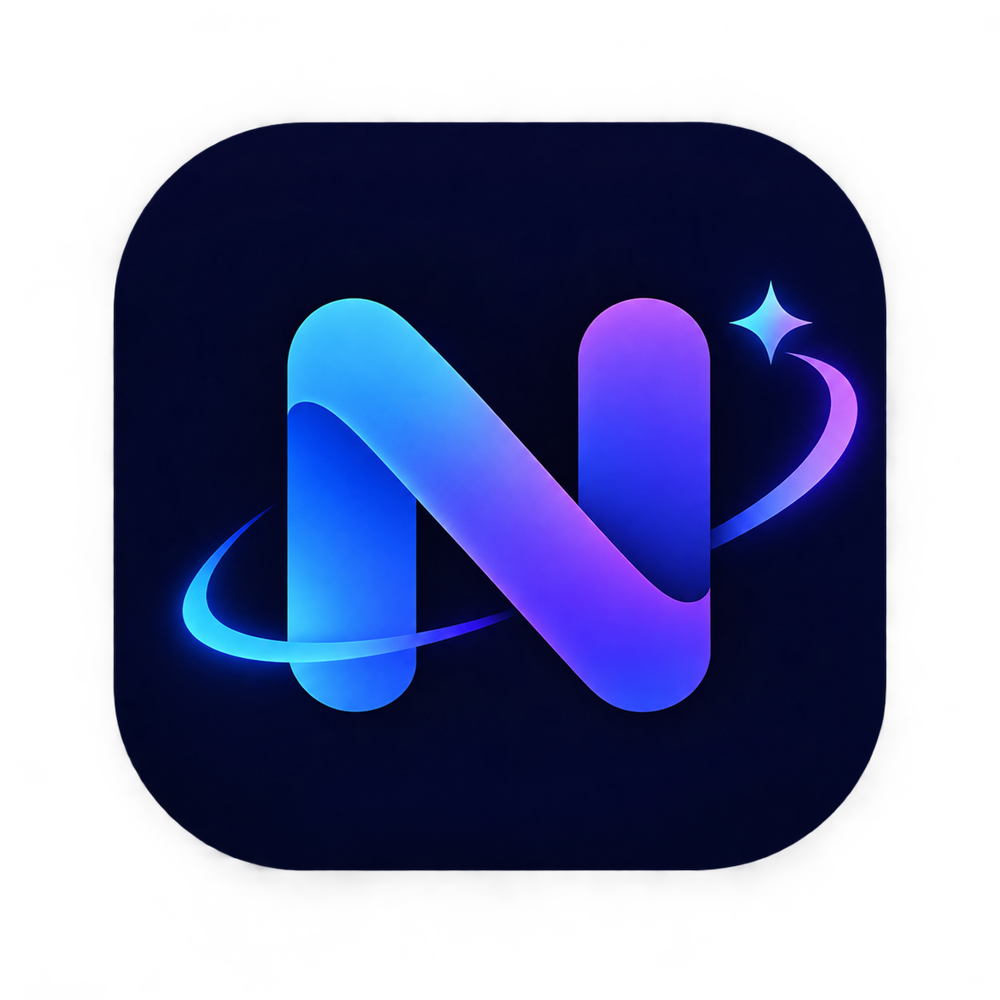
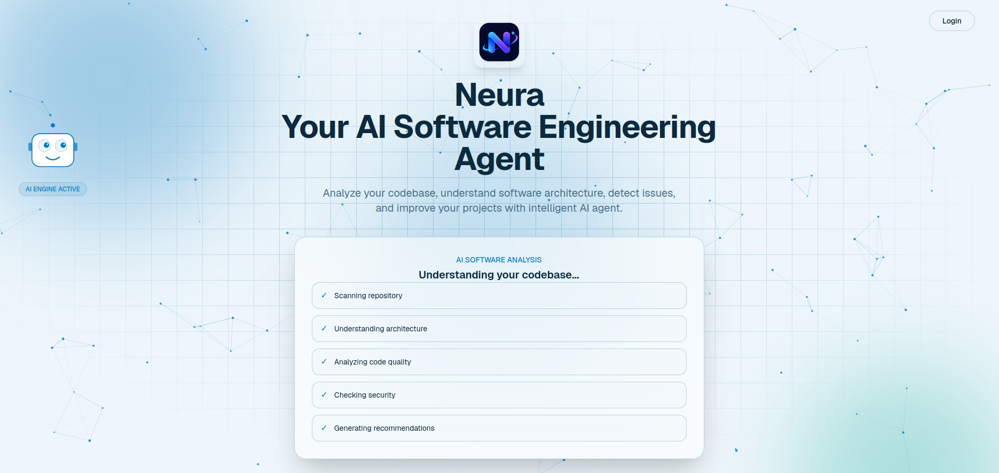
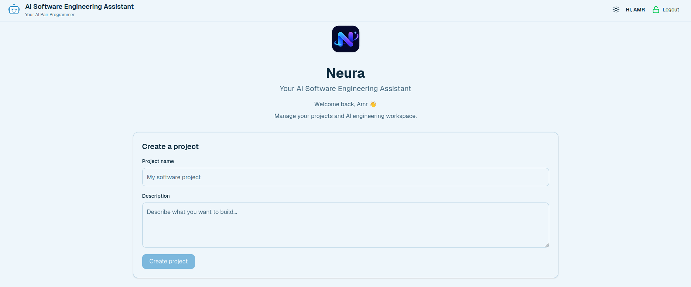
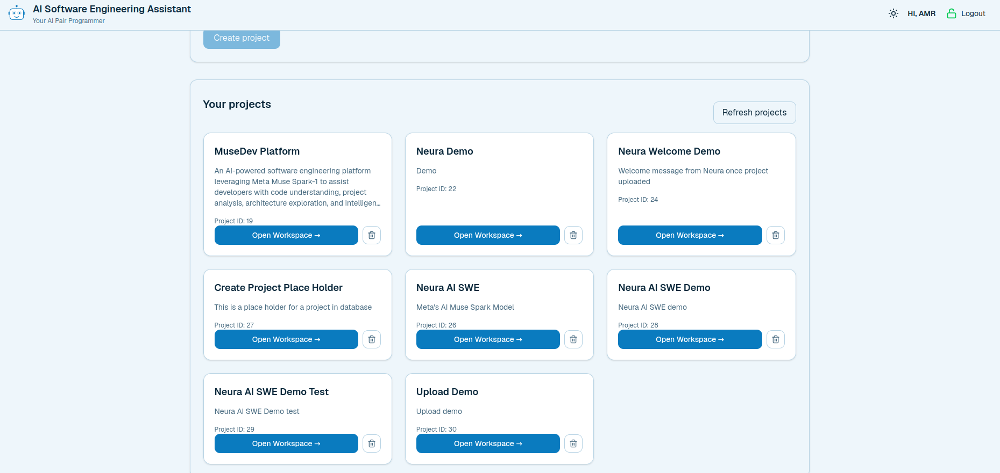
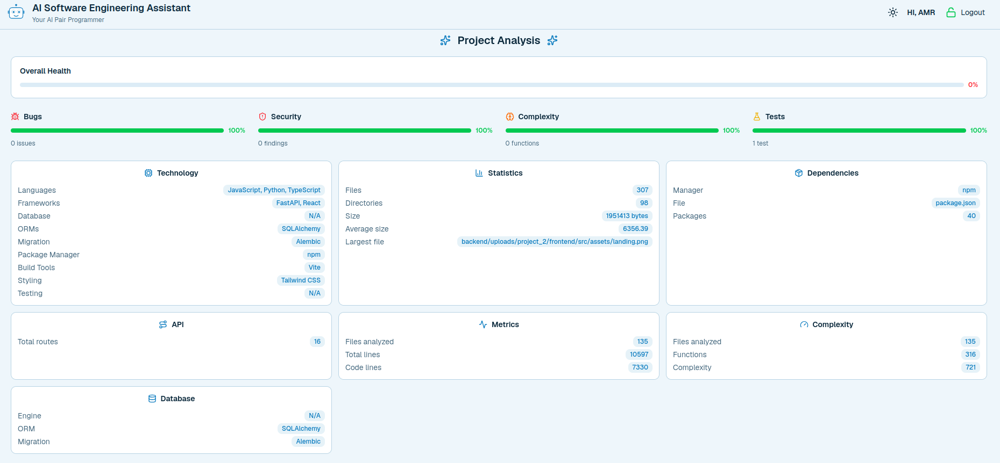
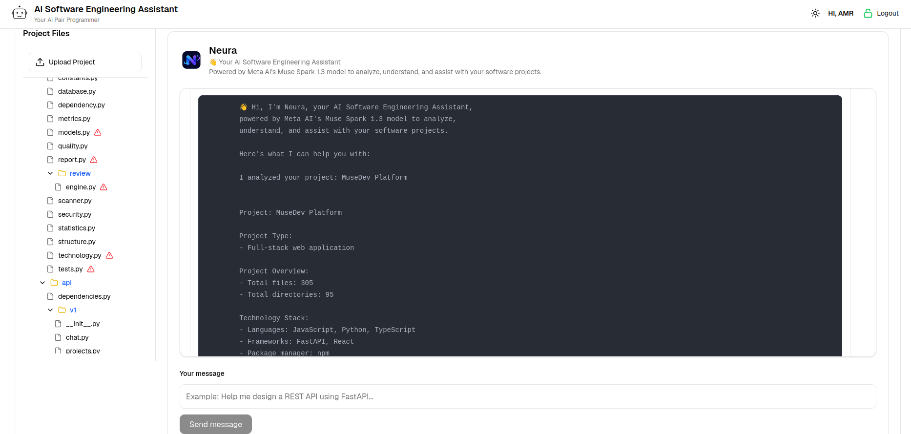

# 🤖 Neura
## AI Software Engineering Agent

<p align="center">
  
</p>
<!-- <p align="center">
  
</p> -->
<p align="center">
  
</p>

<h3 align="center">
Your AI Engineering Partner That Understands Your Codebase
</h3>

<p align="center">
Hackathon version powered by <b>Meta Muse Spark AI</b> for the Meta AI Developer Hackathon 2026
</p>

<p align="center">
  
  
  
  
  
  
</p>

<p align="center">
  <a href="https://neura-client.onrender.com/"></a>
  <a href="https://www.youtube.com/watch?v=kV16cjZw4ok"></a>
  <a href="https://neura-g8wk.onrender.com/health"></a>
</p>

<p align="center">
  <a href="#-overview">Overview</a> •
  <a href="#-demo">Demo</a> •
  <a href="#-problem">Problem</a> •
  <a href="#-solution">Solution</a> •
  <a href="#-architecture">Architecture</a> •
  <a href="#-screenshots">Screenshots</a>
</p>

---

## 🚀 Overview

Neura is an AI-powered software engineering agent that helps developers understand, analyze, and interact with software projects using natural language.

Powered by **Meta Muse AI**, Neura combines a large language model with a secure AI Agent architecture that allows developers to communicate with their codebase.

Instead of only answering questions from general knowledge, Neura can understand uploaded projects, analyze source code, inspect files, and assist developers with engineering tasks.

Neura transforms AI from a chatbot into a **project-aware engineering partner**.

---

## 🎥 Demo

▶️ **Demo Video**

[](https://www.youtube.com/watch?v=kV16cjZw4ok)

🌐 **Live Application:** https://neura-client.onrender.com/

<details>
<summary><b>⚙️ Deployment notes (read before trying the live app)</b></summary>

<br>

Neura has an existing production deployment foundation. The hackathon version extends this foundation by integrating Meta models as the AI reasoning layer.

Neura is deployed on Render. The backend service may require a short startup time after inactivity due to the free-tier sleep behavior.

Before using the application, you can verify that the backend is ready:

Health Check:

```text
https://neura-g8wk.onrender.com/health
```

Once the health check responds, open the live application.

</details>

---

## 💡 Problem

Software developers spend significant time:

- Understanding unfamiliar repositories
- Searching large codebases
- Finding bugs
- Reviewing code quality
- Explaining architecture
- Writing documentation
- Performing repetitive development tasks

Traditional AI assistants often require manually copying code snippets and lack full project context.

---

## 🧠 Solution

Neura provides an AI software engineering agent that can:

✨ Understand uploaded projects  
✨ Analyze source code structure  
✨ Explain architecture  
✨ Review code quality  
✨ Identify potential issues  
✨ Read project files  
✨ Create files  
✨ Modify files  
✨ Delete files  
✨ Answer engineering questions  

Unlike traditional coding assistants, Neura combines repository analysis, engineering tools, and AI reasoning to provide project-level assistance.

Developers interact with Neura in natural language, for example:

<details>
<summary><b>💬 Example prompts</b></summary>

<br>

- "Explain the architecture of this project."
- "Find potential bugs in the authentication module."
- "Review the code quality of this repository."
- "Add a README section describing the API endpoints."

</details>

---

## 🏗️ Architecture

```text
                        ┌──────────────────────────┐
                        │      React Frontend      │
                        │  Chat • Projects • Auth  │
                        └─────────────┬────────────┘
                                      │
                                      ▼
                         FastAPI REST API (/api/v1)
                                      │
                 ┌────────────────────┴────────────────────┐
                 │                                         │
                 ▼                                         ▼
        Authentication                           Project Management
     JWT • Users • Sessions                 Upload • Files • Metadata
                 │                                         │
                 └────────────────────┬────────────────────┘
                                      ▼
                             Agent Service
                                      │
                ┌─────────────────────┼─────────────────────┐
                │                     │                     │
                ▼                     ▼                     ▼
          LLM Client            Tool Execution      Conversation History
        (Muse Spark/OpenAI)      (Function Calls)     (Recent Messages)
                │
                ▼
          Project Analysis
                │
     ┌──────────┼───────────┬───────────┬────────────┐
     ▼          ▼           ▼           ▼            ▼
 Structure   Security    Quality     Metrics    Dependencies
 Analyzer    Analyzer    Analyzer    Analyzer    Analyzer
     │
     ▼
      Project Review Engine
                │
                ▼
        Unified Analysis Result
                │
                ▼
            React Frontend
```

---

## 📸 Screenshots

<details open>
<summary><b>🔐 Login & Authentication</b></summary>

<br>

Secure user authentication to access Neura projects.



</details>

<details>
<summary><b>📁 Project Dashboard</b></summary>

<br>

Create and manage software projects with Neura.




</details>

<details>
<summary><b>🔍 Project Analysis</b></summary>

<br>

Analyze code quality, security, bugs, and technology stack.



</details>

<details>
<summary><b>💬 AI Agent Chat</b></summary>

<br>

Interact with Neura using natural language and project context.



</details>