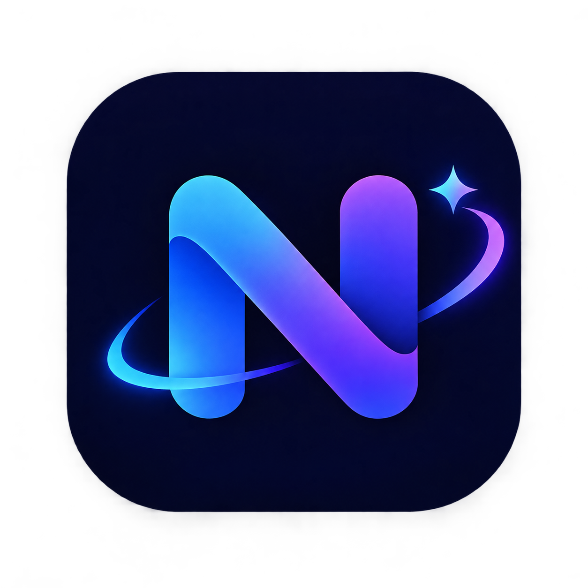

# 🤖 Neura
## AI Software Engineering Assistant

  

<h3 align="center">
Your AI Engineering Partner That Understands Your Codebase
</h3>

Built with <b>Meta Muse AI</b> for the Meta AI Developer Hackathon 2026

---

# 🚀 Overview

Neura is an AI-powered software engineering assistant that helps developers understand, analyze, and interact with software projects using natural language.

Powered by **Meta Muse AI**, Neura combines a large language model with a secure AI Agent architecture that allows developers to communicate with their codebase.

Instead of only answering questions from general knowledge, Neura can understand uploaded projects, analyze source code, inspect files, and assist developers with engineering tasks.

Neura transforms AI from a chatbot into a **project-aware engineering partner**.

---

# 🎥 Demo

▶️ Demo Video:

(Add YouTube Link)

🌐 Live Application:

(Add Deployment URL)

---

# 💡 Problem

Software developers spend significant time:

- Understanding unfamiliar repositories
- Searching large codebases
- Finding bugs
- Reviewing code quality
- Explaining architecture
- Writing documentation
- Performing repetitive development tasks

Traditional AI assistants often require manually copying code snippets and lack full project context.

---

# 🧠 Solution

Neura provides an AI software engineering assistant that can:

✨ Understand uploaded projects  
✨ Analyze source code structure  
✨ Explain architecture  
✨ Review code quality  
✨ Identify potential issues  
✨ Read project files  
✨ Create files  
✨ Modify files  
✨ Delete files  
✨ Answer engineering questions  

Developers interact with Neura naturally:
